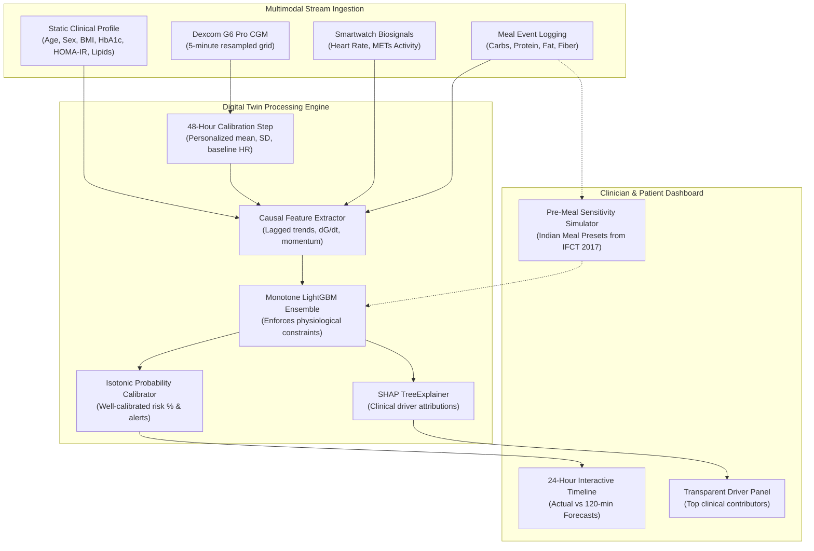

# Glucose Twin: An Explainable Multimodal Digital Twin for Type 2 Diabetes

> **Submission for Happiest Health — Digital Twin Challenge 2026**  
> *Reimagining and Reforming Healthcare in India Summit 2026, Bengaluru*  
> **Track:** Chronic Disease Management (Type 2 Diabetes & Prediabetes)  
> **Repository Access:** Public  

---

## 📋 Quick Links

| Item | Link |
|---|---|---|
| **Project Title** | [Project Title](#-project-title) |
| **Team Details** | [Team Details](#-team-details) |
| **College & Incubator Information** | [College & Incubator Info](#-college--incubator-information) |
| **Problem Statement** | [Problem Statement](#-problem-statement) |
| **Healthcare Use Case** | [Healthcare Use Case](#-healthcare-use-case) |
| **Technical Stack** | [Technical Stack](#-technical-stack) |
| **AI/ML Model & Framework Details** | [AI/ML Model & Framework Details](#-aiml-model-and-framework-details) |
| **15–20 Min Demo Video (Unlisted YouTube)** | [Demo Video Section](#-1520-minute-demo-video) |
| **Architecture Diagram (PDF / PPT)** | [Architecture Diagram Link](#-architecture-diagram-pdf--ppt) |
| **Presentation Deck (PDF / PPT)** | [Presentation Deck Link](#-project-presentation-deck-pdf--ppt) |
| **Open-Source License Details** | [License Details](#-open-source-license-details) |
| **Public Accessibility Statement** | [Public Accessibility](#-public-accessibility-confirmation) |

---

## 👥 Team Details

*Please fill in your team details prior to final submission:*

- **Team Name:** ``
- **Team Leader:**
  - **Full Name:** ``
- **Team Member 2:**
  - **Full Name:** ``
 

---

## 🏛️ College / Incubator Information

- **Institution / College Name:** `Indira Gandhi Delhi Technical University for Women`
- **Department:** `Department of Information Technology (No incubator)`
- **Location:** `Delhi, India`

---

## 🏷️ Project Title

### **Glucose Twin: An Explainable Multimodal Digital Twin for Postprandial Hyperglycaemic Excursion Forecasting & Indian Meal Sensitivity Simulation**

---

## 🩺 Problem Statement

### The Clinical Crisis in India
India faces an escalating metabolic healthcare emergency. According to the landmark **ICMR-INDIAB national study** (*The Lancet Diabetes & Endocrinology* 2023; 11: 474–489):
- **101 million individuals** in India live with diabetes (11.4% prevalence).
- **136 million individuals** live with prediabetes (15.3% prevalence).
- **315 million individuals** suffer from hypertension, and over **254 million** have generalized obesity.

### The Limitation of Conventional Care
Postprandial glucose excursions (spikes $> 180\text{ mg/dL}$) accelerate microvascular complications (diabetic retinopathy, neuropathy, nephropathy) and macrovascular cardiovascular disease. Yet, current clinical management remains **reactive**:
1. **Infrequent Reviews:** Continuous Glucose Monitor (CGM) and HbA1c traces are reviewed retrospectively during consultations weeks or months apart.
2. **Disconnected Streams:** Clinical records (EHR/lab diagnostics) sit in silos, completely disconnected from high-frequency consumer wearable sensors (smartwatch heart rate, METs activity) and dietary meal intake.
3. **Black-Box Guidance:** Existing commercial apps offer generic calorie counts without physiological grounding or actionable explanation of what specifically triggers a patient's hyperglycaemic risk.

### The Digital Twin Objective
To bridge this gap, **Glucose Twin** constructs a virtual, dynamically updating replica of an adult living with type 2 diabetes or prediabetes. The twin fuses:
1. **Static / Historical Profile (EHR):** Demographics, baseline HbA1c, fasting glucose, fasting insulin, HOMA-IR insulin resistance index, and lipid panels.
2. **Dynamic Real-Time Streams:** 5-minute resampled continuous glucose (CGM), smartwatch heart rate, and metabolic equivalent (METs) activity.
3. **Event Streams:** Macronutrient-logged meal events (carbohydrates, protein, fat, fiber).

The system forecasts adverse hyperglycaemic excursions **up to 120 minutes in advance**, highlights transparent clinical drivers via SHAP explanations, and equips clinicians with a **pre-meal what-if sensitivity simulator** tailored to Indian diets.

---

## 💡 Healthcare Use Case

### 1. Proactive Hyperglycaemic Excursion Alerting
Rather than warning a patient after glucose has already spiked past $180\text{ mg/dL}$, Glucose Twin anticipates excursions 30, 60, and 120 minutes in advance. Clinicians configure an alert budget (e.g., $\le 2$ alerts/day) to prevent alert fatigue while maximizing event capture.

### 2. Clinical Explainability & Driver Attribution
Every risk score is decomposed into clinical feature contributions using tree SHAP:
- Identifies whether current risk is propelled by meal carbohydrate load, elevated 30-minute glucose momentum ($dG/dt$), persistent baseline insulin resistance (HOMA-IR), or blunted postprandial physical activity.
- Expressed in clear clinical prose, empowering the healthcare team and dietitian to make targeted lifestyle modifications.

### 3. Pre-Meal "What-If" Sensitivity Simulator (Indian Dietary Presets)
Dietary carbohydrates in India differ significantly in glycemic load and composition. The interactive twin simulator allows a clinician or patient to test meal alternatives *before eating*:
- Integrates calibrated presets from the **Indian Food Composition Tables (NIN-ICMR, IFCT 2017)**, including:
  - *North Indian:* 2 Roti + Dal Tadka + Sabzi (62g C, 18g P, 14g F, 9g Fiber)
  - *South Indian:* 3 Idli + Sambar + Coconut Chutney (58g C, 12g P, 8g F, 6g Fiber)
  - *High-Glycemic:* Masala Dosa + Filter Coffee (74g C, 11g P, 16g F, 4g Fiber)
  - *Poha:* Kanda Poha (48g C, 6g P, 10g F, 3g Fiber)
  - *Balanced Low-Carb Alternative:* Sprouted Moong Salad + Paneer (18g C, 22g P, 14g F, 8g Fiber)
- Evaluates the marginal risk reduction of carbohydrate reduction or fiber enrichment before the meal occurs.

---

## 🛠️ Technical Stack

```
┌─────────────────────────────────────────────────────────────────────────────┐
│                             GLUCOSE TWIN SYSTEM                             │
├──────────────────────────────────────┬──────────────────────────────────────┤
│ FRONTEND LAYER (Clinician UI)       │ BACKEND & ML ENGINE                  │
│ • React 19 + Vite 8                 │ • Python 3.11 + FastAPI + Uvicorn    │
│ • Responsive Glassmorphism Design    │ • LightGBM (Monotone Constraints)    │
│ • Interactive SVG Trajectories      │ • Scikit-Learn (Calibration & CV)    │
│ • Lucide-React Clinical Icons       │ • Tree SHAP (Local Explainability)   │
│ • Guided Clinical Walkthrough Tour  │ • PyArrow & Pandas (Parquet Engine)  │
├──────────────────────────────────────┴──────────────────────────────────────┤
│ STREAM FUSION & DATA ENGINE                                                 │
│ • 5-Minute Uniform Causal Grid Resampler                                    │
│ • 48-Hour Participant Calibration Engine (Personalized Twin Baselines)      │
│ • PhysioNet CGMacros Real Biosignal + Indian Food Composition Tables (IFCT) │
└─────────────────────────────────────────────────────────────────────────────┘
```

- **Backend Framework:** FastAPI with asynchronous Uvicorn server, Pydantic data validation schemas.
- **Machine Learning & Modeling:** LightGBM with monotone domain constraints, Scikit-learn (Isotonic & Sigmoid Probability Calibration), SHAP (TreeExplainer).
- **Frontend Architecture:** React 19 SPA bundled with Vite, modern Vanilla CSS design system (dark mode, glassmorphic cards, micro-animations, accessible high-contrast clinical indicators).
- **Data Serialization:** Apache Parquet, Joblib model persistence, YAML configuration management.

---

## 🧠 AI/ML Model and Framework Details

### 1. Data Fusion Architecture
The pipeline ingests two asynchronous data channels resampled onto a 5-minute causal grid with zero forward-looking leakage:
- **Static Clinical Profile:** Age, sex, BMI, HbA1c, fasting glucose, fasting insulin, HOMA-IR ($(\text{fasting glucose} \times \text{fasting insulin}) / 405$), and lipid panel (triglycerides, HDL, LDL).
- **Dynamic Physiological Series:** Dexcom G6 Pro CGM readings, heart rate (bpm), and metabolic equivalents (METs).
- **Personalized Twin Anchor:** 48-hour warm-up window computing personal mean glucose, glucose standard deviation, typical postprandial rise, and resting heart rate.

### 2. Algorithmic Formulation & Monotonicity Guarantees
- **Target Event:** Consensus clinical hyperglycaemic excursion cut-off ($G \ge 180\text{ mg/dL}$ sustained for $\ge 15\text{ minutes}$) within forecast horizons $H \in \{30, 60, 120\}\text{ minutes}$.
- **Physiological Monotonicity Constraints:** To prevent adversarial or unphysical predictions, the LightGBM model enforces monotone positive constraints on meal carbohydrates and recent glucose rate of change ($dG/dt$). Higher carb intake cannot paradoxically lower predicted excursion risk.
- **Probability Calibration:** Raw ensemble outputs are calibrated via isotonic regression and Platt scaling, evaluated through Brier Score and Expected Calibration Error (ECE).

### 3. Validation Methodology (Zero-Data-Leakage)
- **Validation Scheme:** 5-fold Stratified Group Cross-Validation across 3 random seeds ($5 \times 3 = 15$ folds). Folds are grouped by participant ID so that no participant's data ever appears in both training and test sets.
- **Confidence Intervals:** 1,000 participant-level bootstrap resamples for all reported metrics (AUROC, PR-AUC, Brier score, ECE, lead time).

### 4. Benchmark & Ablation Proof of Fusion (120-Minute Horizon)

#### Primary Model Comparison
| Model | AUROC [95% CI] | PR-AUC [95% CI] | Brier Score | ECE | Event Sensitivity (@ 2 alerts/day) |
|---|---|---|---|---|---|
| **B0a (Trend Arrow Rule)** | 0.624 [0.611, 0.639] | 0.234 [0.194, 0.284] | n/a | n/a | 96.6% *(Severe false alarms: 6.99/day)* |
| **B0b (Simple Meal Rule)** | 0.511 [0.509, 0.513] | 0.148 [0.121, 0.187] | n/a | n/a | 0.0% *(Incapable of continuous timing)* |
| **B1 (Logistic Regression)** | 0.745 [0.690, 0.816] | 0.393 [0.322, 0.464] | 0.104 | 0.030 | 49.7% |
| **B2 (LightGBM Monotone)** | **0.839 [0.802, 0.867]** | **0.507 [0.422, 0.565]** | **0.092** | **0.013** | **55.9% (1.69 alerts/day)** |

#### Stream Fusion Ablation Proof
| Variant | Streams Fused | PR-AUC [95% CI] | AUROC [95% CI] | Clinical Finding |
|---|---|---|---|---|
| **A0** | Dynamic CGM trajectory only | 0.426 [0.365, 0.480] | 0.784 [0.754, 0.810] | Baseline CGM trend alone |
| **A1** | A0 + Macronutrient meal logs | 0.453 [0.393, 0.504] | 0.818 [0.794, 0.837] | Meal macros provide +0.027 PR-AUC lift |
| **A2** | A1 + Smartwatch (HR + METs) | 0.429 [0.375, 0.484] | 0.811 [0.784, 0.829] | Observational wearable noise slight dip |
| **A3** | A2 + Static clinical profile | 0.468 [0.390, 0.535] | 0.823 [0.791, 0.848] | HbA1c/BMI/HOMA-IR phenotypic anchor |
| **A4** | **Full Twin (A3 + 48h Baseline)** | **0.502 [0.432, 0.557]** | **0.835 [0.803, 0.863]** | **Highest performance across all metrics** |
| *Static Only* | Profile only (no dynamic CGM) | 0.273 [0.215, 0.324] | 0.724 [0.658, 0.771] | Proves static EHR alone cannot time excursions |

---

## 🎥 15–20 Minute Demo Video

- **Video Link (Unlisted YouTube):**  
  👉 **`[CLICK HERE TO WATCH THE DEMO VIDEO (UNLISTED YOUTUBE LINK)](https://youtu.be/PLACEHOLDER_VIDEO_ID)`**  
  *(Replace `https://youtu.be/PLACEHOLDER_VIDEO_ID` with your actual unlisted YouTube link)*

### Video Breakdown & Timestamps
- `00:00 - 02:30` : Introduction, India Healthcare Crisis & Problem Statement
- `02:30 - 05:30` : Multimodal Stream Fusion Architecture (EHR + CGM + Wearable + Meals)
- `05:30 - 09:30` : Live Clinician Dashboard Demonstration & Digital Twin Virtual Patient
- `09:30 - 13:00` : Real-Time Excursion Forecasting (30, 60, 120 min) & SHAP Explainability
- `13:00 - 16:30` : Pre-Meal What-If Sensitivity Simulator with Indian Meal Presets (IFCT 2017)
- `16:30 - 19:30` : 5-Fold Group CV Methodology, Ablation Study Proof & Regulatory Disclaimers

---

## 📐 Architecture Diagram (PDF / PPT)

- **PDF Version:** [`[Download Architecture Diagram (PDF)]`](./docs/architecture_diagram.pdf) *(Placeholder: Place your PDF file in `docs/architecture_diagram.pdf`)*
- **PPT / Editable Version:** [`[Download Architecture Diagram (PPTX)]`](./docs/architecture_diagram.pptx) *(Placeholder: Place your PPTX file in `docs/architecture_diagram.pptx`)*

### High-Level Architecture Flowchart



---

## 📊 Project Presentation Deck (PDF / PPT)

- **PDF Version:** [`[Download Presentation Deck (PDF)]`](./docs/project_presentation.pdf) *(Placeholder: Place your presentation PDF in `docs/project_presentation.pdf`)*
- **PPT / Editable Version:** [`[Download Presentation Deck (PPTX)]`](./docs/project_presentation.pptx) *(Placeholder: Place your presentation PPTX in `docs/project_presentation.pptx`)*

---

## 📜 Open-Source License Details

- **Codebase License:** Distributed under the **MIT License**. See [LICENSE](LICENSE) for details.
- **Underlying Dataset License:** Primary physiological and CGM traces are sourced from **PhysioNet CGMacros v1.0.0** (DOI: [10.13026/3z8q-x658](https://doi.org/10.13026/3z8q-x658)), licensed under the **Creative Commons Attribution-NonCommercial-ShareAlike 4.0 International (CC BY-NC-SA 4.0)**.
- **Indian Food Nutritional Reference:** Dietary macronutrient compositions are adapted from the **Indian Food Composition Tables (IFCT 2017)** published by the National Institute of Nutrition (NIN) — Indian Council of Medical Research (ICMR).

---

## 🌐 Public Accessibility Confirmation

- [x] **Public GitHub Repository:** This repository is public and accessible worldwide.
- [x] **No Additional Permissions Required:** All source code, data preprocessing pipelines, validation scripts, reports, documentation, and asset links are publicly accessible without authentication barriers or request-access gates.

---

## 💻 How to Run the Application Locally

### Prerequisites
- Python 3.11+
- Node.js v18+ and npm

### 1. Backend Setup (FastAPI)
```powershell
# 1. Create and activate virtual environment
python -m venv .venv
.\.venv\Scripts\Activate.ps1

# 2. Install dependencies
pip install -r requirements.lock

# 3. Start the FastAPI server (runs on port 8000)
python -m uvicorn app.server:app --port 8000 --host 127.0.0.1
```
*API interactive documentation will be live at `http://127.0.0.1:8000/docs`.*

### 2. Frontend Setup (React + Vite)
In a separate terminal window:
```powershell
# 1. Navigate to frontend folder
cd frontend

# 2. Install dependencies & run Vite dev server
npm install
npm run dev
```
*Open `http://localhost:5173` in your web browser.*

### 3. Reproducing Training, Cross-Validation & Ablations
To retrain the models and regenerate the cross-validation metrics, figures, and ablation tables:
```powershell
python scripts/download_cgmacros.py
python scripts/audit.py
python scripts/build_dataset.py
python scripts/train.py
```

---

## ⚖️ Clinical & Regulatory Disclaimers

1. **Research Prototype Only:** Glucose Twin is an academic proof-of-concept research prototype developed for demonstration and evaluation. It is **not** a cleared or certified medical device, does not provide medical diagnoses, and does not prescribe insulin or clinical therapy.
2. **Honesty & Demographic Scope:** The primary biosignal dataset contains 45 adult participants recruited in California, USA. It does not claim clinical validation on Indian populations. Indian meal presets are an illustrative extrapolation using ICMR-NIN IFCT tables for clinician sensitivity exploration.
3. **Mandatory Advisory Notices:**
   - *"Advisory forecast from a research prototype. Not a diagnosis."*
   - *"Sensitivity analysis on model inputs. Not a treatment simulation, not proof of causation, not medical advice."*
   - *"Replay of recorded data. Not a live patient."*
